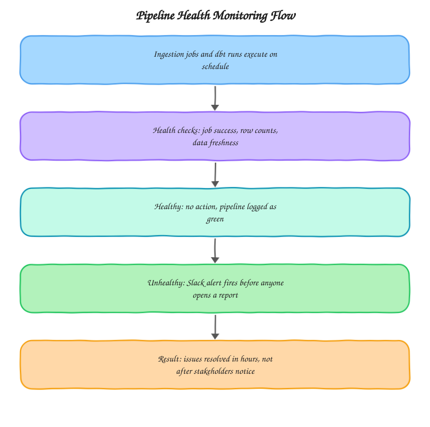

# Pipeline Health Monitor

A monitoring layer for the pipeline itself, ingestion jobs and dbt runs, distinct from monitoring the business metrics that pipeline produces. Built from the kind of proactive monitoring setup I do at [motabar.builds.stuff](https://motabarbuildstuff.com/) so a team hears about a broken job within the hour instead of noticing a stale dashboard days later.

## The problem this solves

Most anomaly detection watches business numbers: did revenue drop, did spend spike. That catches real business problems, but it's blind to a specific failure mode, the pipeline itself silently breaking. A failed extraction job, a dbt model that errors out, a source table that stops updating, none of these show up as an anomalous business metric, they show up as a report that just quietly stops updating and nobody notices until someone asks why last week's numbers look the same as this week's. This project watches the plumbing, not just the water.

## Architecture

This sits upstream of business metric anomaly detection, not in place of it. A healthy pipeline can still produce anomalous business numbers, that's a real signal worth a different kind of alert. This project's job is narrower and more urgent: make sure the numbers being evaluated are actually fresh and complete in the first place.

## What's in here

* `python/pipeline_health_check.py` checks job completion status, row count sanity, and data freshness for every table in the pipeline, and sends a Slack alert the moment something looks wrong

## How it's used in practice

The health check runs three kinds of tests per table: whether the load job actually completed successfully, whether the row count for the latest load is within a reasonable range of recent loads (catching a partial or empty load that technically "succeeded"), and whether the most recent row's timestamp is as fresh as expected given the table's normal update cadence. Any one of these failing triggers an immediate Slack alert naming the specific table and the specific check that failed, so whoever's on call knows exactly where to look without first having to figure out something's wrong.

## Why row count and freshness checks matter as much as job status

A load job can report success while still producing bad data, an API that returns an empty response due to an expired token still gets logged as a "successful" load with zero new rows. Job status alone would miss this every time. The row count and freshness checks catch failure modes that don't look like failures from the orchestrator's point of view.

## Setup

1. List every table in the pipeline that needs monitoring, along with its expected update cadence
2. Configure `pipeline_health_check.py` with the table list and reasonable row count and freshness thresholds per table
3. Schedule the health check to run shortly after the main pipeline's scheduled completion time
4. Connect a Slack webhook for alerts

## Stack

Python, BigQuery, dbt, Slack API

## Related

* Case study: [Proactive Insight Delivery With Slack Alerts](https://motabarbuildstuff.com/case-studies/proactive-insight-delivery-with-slack-alerts/)
* Guide: [Why is my GA4 direct traffic so high?](https://motabarbuildstuff.com/blog/why-is-ga4-direct-traffic-so-high/)
* Service: [All analytics and tracking services](https://motabarbuildstuff.com/services/)

Built by [Motabar Javaid](https://motabarbuildstuff.com/about/), analytics engineer at [motabar.builds.stuff](https://motabarbuildstuff.com/).
